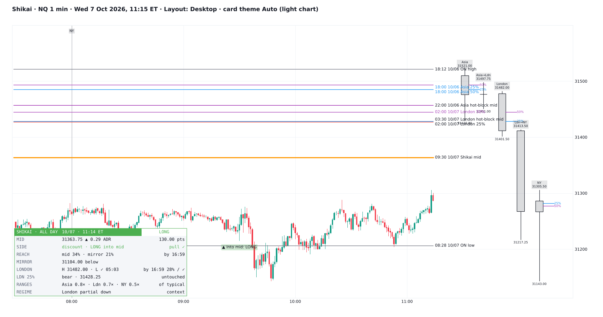
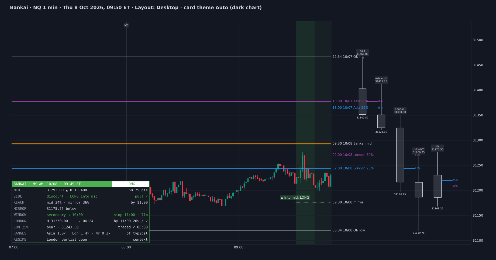
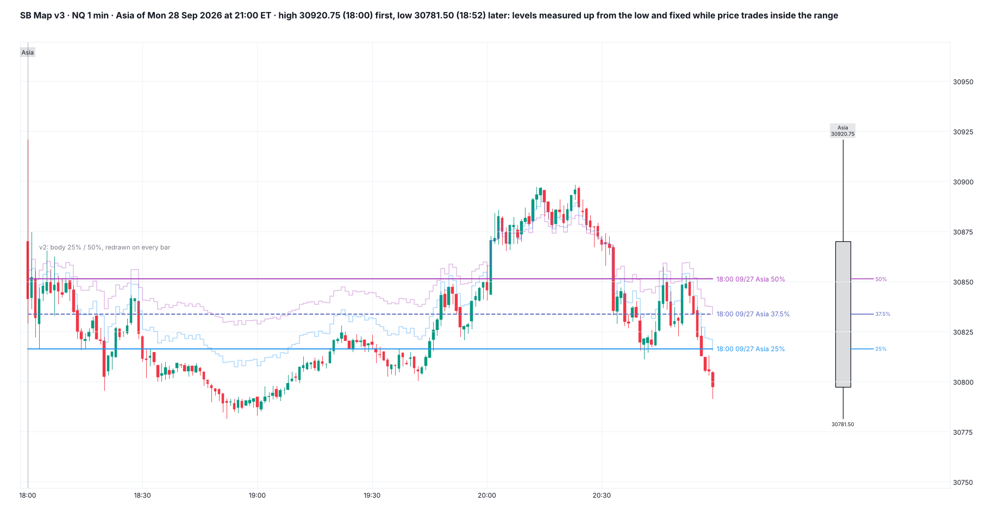
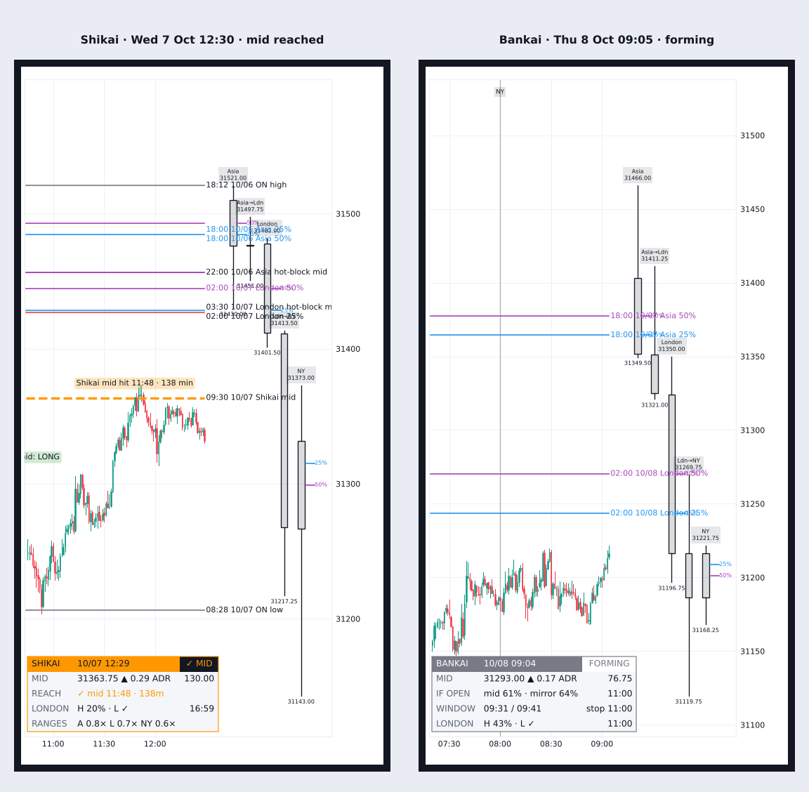

# Shikai / Bankai Session Map

**Overnight midpoint, session candles and Asia / London levels for NQ, ES and RTY**

TradingView indicator, Pine Script v6. Open source under the Mozilla Public License 2.0.

*Mock-up of how it looks on the chart.*

**Shikai / Bankai Session Map** maps the overnight session onto the New York day.

- **Shikai:** the overnight midpoint as an all-day reference, to 16:59 ET.
- **Bankai:** the same midpoint inside a time-bound New York AM window, to 11:00 ET.

## What it draws

- **Session candles** for Asia, London and New York, drawn to the right of price (15–65 bars out).
- **The overnight midpoint** (18:00 → 09:30) and its **mirror**: the same distance from the 09:30 open on the other side, dotted.
- **Asia and London levels:** 25%, 37.5% and 50% of each session's range.
  - They are retracement levels of the high–low, measured from whichever extreme came last.
  - They change only when the session makes a new high or low.
  - The older body (open–close) method is still a setting.
- **Hot-block midpoints:** the midpoint of each session window's widest finished 30-minute block.
- **Bankai windows** (primary and secondary) and the entry markers.
- Labels within 2.5% of ADR20 of each other share one stacked label.

## The card

- **Header:** mode, date and time, and a pill:
  - FORMING before 09:30;
  - LONG / SHORT (the side into the midpoint);
  - ✓ MID once it is reached;
  - OVER when the window ends without it.
- **MID:** the overnight midpoint and its distance from the 09:30 open, in ADR20 and points.
- **SIDE:** discount (long into the mid) or premium (short into the mid), and whether the tested pull applies.
- **REACH:** the live odds of reaching the midpoint by 16:59 (Shikai) or 11:00 (Bankai), against its mirror; then the time it was reached.
- **MIRROR:** the same distance on the other side of the open.
- **WINDOW** (Bankai): primary or secondary window open, or entries closed, and the minutes to the hard stop.
- **LONDON:** the London high and low taken after 05:00, with times, and live odds for the ones not yet taken.
- **LDN 25%:** London's 25% level, traded or untouched, with the leg (up or down).
- **RANGES:** the Asia, London and New York ranges against a typical day's.
- **REGIME:** London against Asia, as context.
- Before 09:30 it shows the overnight range so far, and the odds if the session opened at the current price.

## What the tests showed

NQ, ES and RTY 1-minute data 2018–26 (6,344 days). Each held in 2018–24 and 2025–26 and on each symbol.

- **The midpoint overall:** reached about as often as its mirror (by 16:59, 76.5% vs 75.6%). It is not a magnet in general.
- **Discount opens** 0.1 ADR or more from the mid reached it 5–6 points more often than an equal level above the open:
  - by 11:00: 53% vs 47% (p 0.002);
  - by 16:59: 69% vs 64% (p 0.01).
- **Premium opens** show no pull.
- **The London high** is taken by 11:00 on 75% of days and by 16:59 on 83%. The low: 71% / 79%. Both: 48% / 62%.
- **London's 25% level** was reached by 11:00 on 91% of days and by 16:59 on 94% (after 05:00). The 37.5%: 90% / 93%. The 50%: 86% / 90%.

## Settings

**View** sits at the top:
- card theme;
- layout (Desktop / Mobile);
- card on/off and position;
- card text;
- chart text size and colour.

Then:
- **Mode** (Shikai or Bankai);
- **sessions**;
- **the midpoint map**;
- **hot-block midpoints**;
- **intraday markers**;
- **session candles**, including the 25 / 37.5 / 50% method and the 37.5% toggle.

## How to use

- Built for **NQ / MNQ**, **ES / MES** and **RTY / M2K** on intraday ETH charts (1-minute in the screenshots).
- If you also run Hadō 99, set Hadō 99's preview offset to 70 or more so its candles sit beyond these session candles.

*Historical frequencies, not guarantees.*

## Add it to TradingView

1. In TradingView, open the **Pine Editor** (bottom panel).
2. Copy the contents of `Shikai_Bankai_Session_Map.pine` into a new script.
3. **Save**, then **Add to chart**.

## More screenshots

## License

Mozilla Public License 2.0, see [LICENSE](LICENSE). © Unclehk2000.

*Historical frequencies, not guarantees. Nothing here is financial advice.*
